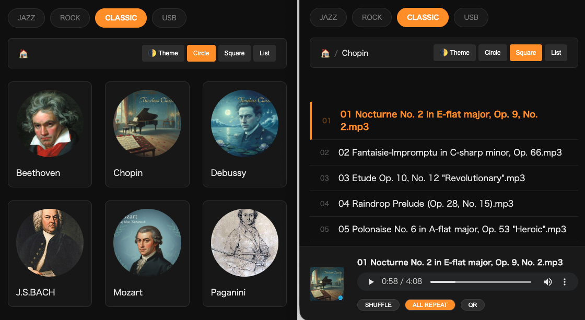

# mp3-dana (MP3棚)
A minimalist, folder-based web music player in a single PHP file.  
PHP 1ファイルで動作する、フォルダ構造を活かした軽量ミュージックプレイヤー。

<p align="center">
  
  <br>
  <i>Dark Mode: Circle view (Left) and Square/List view (Right)</i>
</p>

## Concept / コンセプト
**"A simple shelf for your music."** **「音楽のための、シンプルな棚」**

mp3-dana is a tiny script that turns your messy music directories into a functional web player instantly. No database, no complex installation—just drop and play.  
mp3-danaは、音楽フォルダを即座にWebプレイヤー化する軽量スクリプトです。データベースは不要。ファイルを置いて読み込むだけで、あなたの音楽ライブラリをブラウザで楽しめます。

## Features / 特徴
- **Zero Config**: Single-file PHP script (+ ID3 library).  
  **ゼロ設定**: PHP 1ファイルで動作（+ ID3ライブラリ）。
- **Folder-Centric**: Respects your directory structure.  
  **フォルダ中心**: フォルダ構造をそのままリスペクト。
- **Rich Metadata**: Automatic extraction of cover art and lyrics from ID3 tags.  
  **豊かなメタデータ**: ID3タグからジャケット画像や歌詞を自動抽出。
- **Compatible Cover Art**: Reuses suitable external JPEG artwork; otherwise generates an RGB JPEG cache (up to 1200 px on either side) from embedded artwork.  
  **互換性を考慮したカバー画像**: 条件に合う外部JPEGを直接利用し、必要な場合は埋め込み画像からRGB JPEGキャッシュを生成（長辺最大1200px）。
- **Theme Support**: Dark and Light modes.  
  **テーマ対応**: ダーク・ライトモード切替。
- **Private & Safe**: Designed for intranet/LAN use.  
  **プライベート設計**: イントラネット・個人利用に最適化。
- **QR Sync**: (Optional) Scan to sync folders to your phone.  
  **QR同期**: スマホでQRコードを読み取りフォルダを引き継げます（任意）。
- **Synchronized Lyrics (.lrc)**: If a `.lrc` file with the same basename as the audio file is placed in the same folder, mp3-dana displays synchronized lyrics that follow playback. The current line is highlighted and automatically scrolled into view. Clicking a lyric line seeks playback to that timestamp.  
  **同期歌詞（.lrc）対応**: 音声ファイルと同じフォルダに、同じベース名の `.lrc` ファイルを配置すると、再生位置に同期して歌詞を表示します。現在行をハイライトし、自動スクロールします。歌詞行をクリックすると、その時刻へシークできます。

## Installation / 設置方法

1. **Download index.php** to your web directory.  
   `index.php` をWeb公開ディレクトリに配置します。

2. **Configure Folders**: Open `index.php` and update the `$allowedRoots` section with your music folder paths.  
   `index.php` を開き、`$allowedRoots` セクションをご自身の音楽フォルダのパスに合わせて書き換えます。

3. **Install getID3**: Place the [getID3](https://www.getid3.org/) library in a directory named `/getid3` (next to `index.php`).  
   [getID3](https://www.getid3.org/) ライブラリを `/getid3` という名前のフォルダで配置します（`index.php` と同じ階層）。

4. **Enable PHP GD for artwork conversion**: PNG and other supported embedded images are decoded and saved as JPEG using the GD extension.  
   **カバーアート変換にはPHP GD拡張が必要です**。PNG等の埋め込み画像をJPEGへ変換する場合に使用します。Ubuntuの例：`sudo apt install php-gd`。Webサーバで使用するPHPにもGDが必要です。

5. **Optional QR Sync**: Place `qrcode.min.js` next to `index.php`.  
   （任意）`qrcode.min.js` を `index.php` と同じ階層に配置するとQRコード同期が有効になります。

6. **Access via Browser**: Open the directory in your web browser.  
   ブラウザでアクセスして完了です。

## Album Art / カバーアート

`mp3-dana` checks album artwork in this order (with the default settings):

1. If `cover_cache.jpg` exists, reuse it **without checking image format or dimensions** (`$coverValidateCache = false`).
2. Otherwise, look for an external **actual JPEG** in the same directory using the following names, in order:
   `Cover.jpg`, `cover.jpg`, `AlbumArtSmall.jpg`, `albumartsmall.jpg`, `AlbumArt.jpg`, `albumart.jpg`, `Album.jpg`, `album.jpg`, `Folder.jpg`, `folder.jpg`, `Thumb.jpg`, `thumb.jpg`.
   An external file is used directly only when its width and height are each at most 1200 px.
3. Otherwise, extract artwork from audio-file metadata and generate `cover_cache.jpg` in RGB JPEG format with aspect ratio preserved and the longest side at most 1200 px. Transparent areas become white.
4. If no suitable image can be obtained, show a placeholder image.

標準設定では、`cover_cache.jpg` があれば形式・サイズのチェックをせず最優先で利用します。キャッシュがない場合のみ、上記のファイル名の外部JPEG画像を順に確認します。どちらも使えなければ、MP3等の埋め込み画像から `cover_cache.jpg` を生成します。PNGを`.jpg`と名付けただけの画像は、外部JPEGとして直接利用しません。

The settings are defined near the beginning of `index.php`:

```php
$coverMaxSize = 1200;       // Maximum width or height
$coverJpegQuality = 85;     // JPEG quality (0-100)
$coverValidateCache = false; // Fast mode: trust an existing cache
```

Setting `$coverValidateCache = true` validates existing caches before use. With this setting, a compatible external JPEG may be preferred over an existing cache. Validation reads image metadata and can slow directory listings.  
`$coverValidateCache = true` にすると既存キャッシュを検証します。検証を有効にすると、適合する外部JPEGが既存キャッシュより優先される場合があります。多数のフォルダでは表示が遅くなることがあります。

**Old caches / 既存キャッシュ:** Existing `cover_cache.jpg` files are not automatically converted in fast mode, even if their actual format is PNG or they are oversized. Run a separate maintenance pass or enable cache validation when migrating existing images. The application does not delete older caches automatically.  
**既存キャッシュ:** 高速モードでは、PNG形式のままの `cover_cache.jpg` や巨大画像を自動修正しません。必要に応じて保守用バッチなどで一括整備してください。既存キャッシュの自動削除は行いません。

## Synchronized Lyrics / 同期歌詞

mp3-dana supports standard LRC lyric files.

mp3-danaは、標準的なLRC形式の同期歌詞に対応しています。

Place the `.lrc` file in the same directory as the audio file and use the same basename.

`.lrc` ファイルは音声ファイルと同じフォルダに置き、拡張子以外のファイル名を同じにしてください。

Example / 例:

```text
01-Song.mp3
01-Song.lrc
```

Example LRC content / LRCファイル例:

```lrc
[00:12.50]First lyric line
[00:16.20]Second lyric line
[00:20.10]Third lyric line
```

When synchronized lyrics are available:

- The current lyric line is highlighted.
- Lyrics automatically scroll with playback.
- Clicking a lyric line seeks playback to that timestamp.
- Manual scrolling temporarily disables automatic following.
- The `FOLLOW` button returns to the current playback position.
- The `FOCUS` button provides a simplified current-line-oriented view.
- `[offset:]` in LRC files is supported.

同期歌詞がある場合は、以下の機能を利用できます。

- 現在再生中の歌詞行をハイライト
- 再生位置に合わせた自動スクロール
- 歌詞行クリックによるシーク
- 手動スクロール時の自動追従停止
- `FOLLOW` ボタンによる現在位置への復帰
- `FOCUS` ボタンによる簡易表示
- LRCの `[offset:]` に対応

If no matching `.lrc` file exists, mp3-dana falls back to lyrics embedded in the ID3 tag as before.

同名の `.lrc` ファイルが存在しない場合は、従来どおりID3タグ内の歌詞を表示します。

## Optional Features / 追加機能

You can unlock these powerful tools by adding small external libraries.  
外部ライブラリを追加することで、以下の便利な機能が利用可能になります。

- **QR Sync (via [qrcodejs](https://github.com/davidshimjs/qrcodejs))** Scan the QR code to instantly sync and open the current folder on your mobile device. Perfect for "handing over" music from PC to phone.  
  **QR同期**: QRコードをスキャンして、現在開いているフォルダをスマホへ引き継げます。

## Notes & Limitations / 注意事項と制限

- **Initial Loading Time**: Missing artwork can trigger audio-file scanning and JPEG cache generation while folders are being listed. Once a cache exists, default fast mode reuses it without image validation.  
  **初回の読み込み時間**: カバー画像がない場合はフォルダ表示中にMP3等の解析・キャッシュ生成を実行するため時間がかかることがあります。キャッシュ生成後は標準設定で検証を省略します。

- **Metadata Dependence**: Album artwork and lyrics depend on existing metadata. We recommend tools such as Mp3tag to organize your library.  
  **メタデータへの依存**: 画像や歌詞はメタデータに依存します。Mp3tag等での整理を推奨します。

- **No Playlist Feature**: Designed for album-by-album listening; does not support cross-folder playlists.  
  **プレイリスト機能なし**: フォルダを跨ぐプレイリスト機能はありません。

- **File Permissions**: Creating `cover_cache.jpg` requires write permission in the music folder.  
  **ファイル権限**: キャッシュ生成には対象の音楽フォルダへの書き込み権限が必要です。

- **LRC Timing Accuracy**: Lyrics synchronization depends on timestamps stored in `.lrc`; mp3-dana does not analyze vocals or create timestamps.  
  **LRCの同期精度**: `.lrc` のタイムスタンプに依存します。自動で歌声解析やタイムスタンプ生成は行いません。

## Security Notice / セキュリティについて
This app is for **private intranet use only**. It has no authentication.  
本ツールは**イントラネット内での個人利用**を想定しています。認証機能はありませんので、インターネット上への直接公開は避けてください。

## License
MIT License
